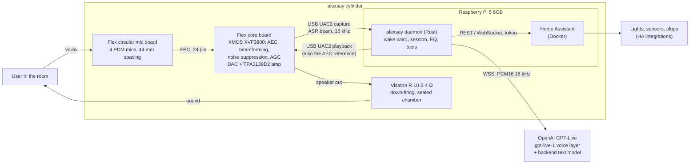

# Architecture

## System overview



One USB device does both capture and playback. That single fact carries the design: the XVF3800 subtracts exactly the signal it is playing, so there is no external reference path, no clock drift between two sound cards and no delay tuning.

## Hardware signal path

- **Capture:** 4 PDM mics → XVF3800 → USB. With the 6-channel firmware: ch0 conference beam, ch1 ASR beam (what the daemon uses), ch2 to ch5 raw mics (wake-word training data, debugging).
- **Playback:** daemon → USB → XVF3800 (takes it as the AEC far-end reference) → DAC → amp → R 10 S.
- **Power:** one 27 W USB-C PSU into the Pi; the Flex is powered from the Pi's USB port. Nothing else.

## Software components

| Component | Runs as | Job |
|---|---|---|
| `alexsay` daemon | systemd service, Rust | ALSA capture/playback, wake word, session state machine, resampling, playback EQ, OpenAI WebSocket client, tool calls |
| Wake word | in the daemon (openWakeWord ONNX models via ONNX Runtime) | Spots "Alex" on the ASR beam; Phase 1 may use the `wyoming-openwakeword` container instead |
| Home Assistant | Docker, host network | Device integrations; the daemon calls its API |
| OpenAI GPT-Live | cloud | Speech in, speech out, turn-taking; delegates reasoning and tool calls to a backend text model (Responses delegation) |

Details: [software.md](software.md).

## Session flow

```mermaid
sequenceDiagram
    participant U as User
    participant X as XVF3800
    participant D as alexsay daemon
    participant O as OpenAI GPT-Live
    participant H as Home Assistant

    U->>X: "Alex, turn off the kitchen lights"
    X->>D: ASR beam, 16 kHz (continuous)
    D->>D: wake word fires; 2 s ring buffer already holds the request
    D->>O: WSS connect, session.start (pcm 16 kHz, voice, delegation + tools)
    O-->>D: session.started
    D->>O: session.input_audio.append (buffered audio, then live)
    O-->>D: response.event: function call ha_call_service(light.turn_off, kitchen)
    D->>H: POST /api/services/light/turn_off
    H-->>D: 200
    D->>O: response.item.create (function_call_output), response.create
    O-->>D: session.output_audio.delta (16 kHz)
    D->>X: EQ, play
    U->>X: "...and the hallway too" (barge-in while it speaks)
    Note over O: GPT-Live hears both sides and yields the turn itself
    D->>D: drop queued playback when output stops (keep the queue short)
    Note over D,O: conversation continues, no wake word needed
    D->>O: session.close after idle timeout or end_conversation tool
```

- The daemon streams mic audio for the whole session. The **XVF3800's AEC** keeps the assistant's own voice out of that stream, and **GPT-Live's native turn-taking** decides who speaks. Both are needed: without AEC the model hears itself and interrupts itself.
- The wake word only runs while idle. In a session, "Alex" is just a word.
- Event names follow the GPT-Live WebSocket guide (Oct 2026); check them against the API reference when writing the client.

## Key constraints

| Constraint | Value | Source of truth |
|---|---|---|
| Device audio | 16 kHz (6 ch or 2 ch firmware) or 48 kHz (2 ch firmware) | [device-design.md](device-design.md#firmware-choice) |
| GPT-Live audio | PCM16 mono 16 kHz (or 24 kHz), set at `session.start`, both directions | OpenAI Live WebSockets guide |
| USB current on Pi 5 with 27 W PSU | 1.6 A total | Raspberry Pi docs |
| Flex amp on USB 5 V | ~3 W into 4 Ω (estimate, to measure) | [measurements.md](measurements.md) |
| GPT-Live API | GA since 10 Sep 2026; $0.05/min + backend model; paid tiers only | [software.md](software.md#voice-backend) |
| Cloud dependency | No internet, no conversation. Home Assistant automations keep working locally | this doc |
