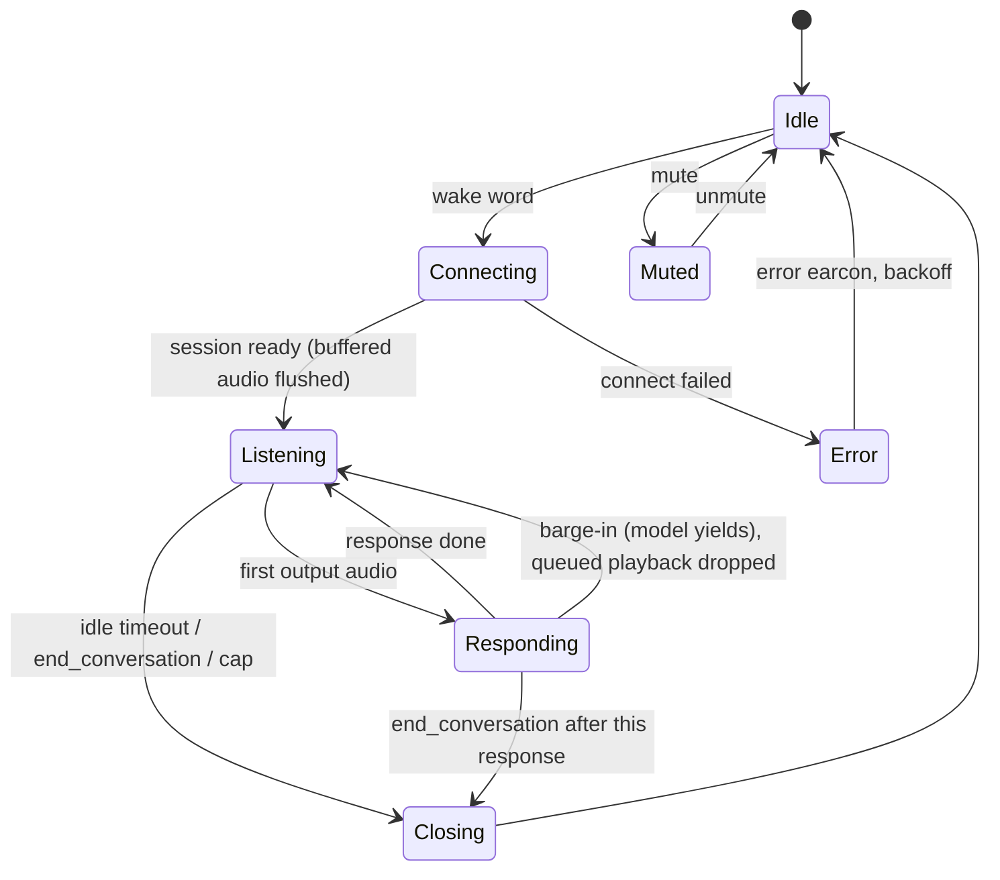

# Software

Design only; no code yet. Everything in the conversation path is one Rust daemon, `alexsay`. Home Assistant runs beside it in Docker.

## Repository layout (planned)

Same conventions as LetterBox: Nix flake, `just` recipes, host-tested logic separated from I/O.

| Path | What |
|---|---|
| `core/` | No I/O, host-tested: session state machine, GPT-Live and realtime event types (serde), playback EQ (biquads), resampler wrapper, ring buffer, tool schemas and argument validation |
| `daemon/` | The `alexsay` binary: ALSA capture/playback (`alsa`), WebSocket client (`tokio-tungstenite`), Home Assistant client (`reqwest`), wake word (`ort`, ONNX Runtime), systemd notify |
| `deploy/` | `alexsay.service`, Home Assistant `compose.yaml`, udev rule for the Flex (vendor `2886`) |
| `scripts/` | Wake-word recording and dataset tools |
| `flake.nix`, `justfile` | Toolchain incl. `aarch64-unknown-linux-gnu` cross target; `just test`, `just build-device`, `just deploy-device`, `just logs` |

## State machine



- Wake-word detection runs only in `Idle`. In a session "Alexsay" is an ordinary word.
- Mic audio streams to the backend for the whole session; GPT-Live decides turns (native full-duplex turn-taking).
- `Connecting` never drops audio: capture keeps filling the ring buffer and the whole backlog is sent once the socket is ready.

## Audio

| Path | Format | Notes |
|---|---|---|
| Capture (Flex, 6 ch image) | 16 kHz, 32-bit, 6 ch | use ch1 (ASR beam); ch2 to ch5 only for recording datasets |
| Capture (Flex, 48 kHz image) | 48 kHz, 2 ch | ch1 ASR beam |
| GPT-Live in/out | PCM16 mono 16 kHz (`audio/pcm`, `rate: 16000`), base64 in JSON events | fixed at `session.start` for both directions; matches io16, so no resampling |
| `gpt-realtime` fallback in/out | PCM16 mono 24 kHz | needs resampling |
| Playback (Flex) | 16 kHz or 48 kHz to match the image | exact channel count/format from `aplay --dump-hw-params` on the bench |

- Open ALSA devices **by card name** from config, never by index (indices move with USB order).
- 10 ms periods, 4-period buffer. Audio threads run `SCHED_FIFO`.
- Resampling with `rubato` only where rates differ: io48 firmware (48 to 16 kHz) or the `gpt-realtime` fallback (16 to 24 kHz).
- Playback chain: 16 kHz deltas → EQ (high-pass ~150 Hz, peaking cut at the box's fc, see [device-design.md](device-design.md#acoustics)) → limiter at −3 dBFS → ALSA. All of it before the XVF3800, so its AEC reference matches what the speaker plays.
- Keep the playback queue short (≤ 100 ms ahead of the DAC) so a barge-in stops the voice quickly. Playback position = frames written minus `snd_pcm_delay`; the `gpt-realtime` fallback needs it for `conversation.item.truncate`.
- Ring buffer: 2 s of ASR-beam audio, always running, so "Alexsay, turn the lights off" spoken in one breath arrives whole.

## Voice backend

```rust
trait VoiceBackend {
    async fn connect(&self, config: &SessionConfig) -> Result<Box<dyn VoiceSession>, BackendError>;
}

trait VoiceSession {
    async fn send_audio(&mut self, pcm16_24k: &[i16]) -> Result<(), BackendError>;
    async fn next_event(&mut self) -> Result<SessionEvent, BackendError>;
    async fn send_tool_result(&mut self, call_id: &str, output: serde_json::Value) -> Result<(), BackendError>;
    async fn interrupt(&mut self, item_id: &str, played_ms: u32) -> Result<(), BackendError>;
    async fn close(self: Box<Self>) -> Result<(), BackendError>;
}
```

| Backend | Endpoint | Model | Status |
|---|---|---|---|
| `Live` | `wss://api.openai.com/v1/live/sessions` | `gpt-live-1` | **Primary.** GA since 10 Sep 2026, $0.05/min billed per second plus the delegated backend model; paid tiers only (Free not supported), 50 concurrent sessions on Build tier |
| `Realtime` | `wss://api.openai.com/v1/realtime?model=gpt-realtime` | `gpt-realtime` | Fallback, same trait |

GPT-Live events the daemon uses (WebSocket guide, Oct 2026; confirm against the API reference when writing the client):

| Direction | Event | Use |
|---|---|---|
| out | `session.start` | first message: `model`, instructions, `audio.format {type: audio/pcm, rate: 16000}`, `audio.output.voice`, `delegation {type: responses, responses: {model, instructions, tools, tool_choice}}` |
| in | `session.started` | session id; only then send audio |
| out | `session.input_audio.append` | mic audio (raw PCM, base64, even byte length) |
| out | `session.input_audio.mute` / `.unmute` | daemon mute state (doesn't stop speech already generated) |
| in | `session.output_audio.delta` | playback |
| in | `session.input_transcript.delta`, `session.output_transcript.delta` | logs |
| in | `response.event` wrapping `response.output_item.done` (function call: `call_id`, `name`, `arguments`) | run a tool |
| out | `response.item.create` (`function_call_output`, matching `call_id`), then `response.create` | tool result |
| out | `session.update` / in `session.updated` | change instructions, tools |
| out | `session.close` / in `session.closed` | end of session |
| in | `error` | log, earcon, close |

- Delegation mode is fixed per session; GPT-Live speaks while the backend model reasons and calls tools.
- Interruption events aren't documented in the WebSocket guide; read "Managing sessions" (`docs/guides/live-conversations`) before writing the playback flush.

`gpt-realtime` fallback events (GA names):

| Direction | Event | Use |
|---|---|---|
| out | `session.update` | instructions, voice, PCM 24 kHz in/out, `semantic_vad`, tools |
| out | `input_audio_buffer.append` | mic audio |
| out | `conversation.item.create` (`function_call_output`) + `response.create` | tool results |
| out | `response.cancel`, `conversation.item.truncate` | barge-in |
| in | `input_audio_buffer.speech_started` | barge-in trigger while `Responding` |
| in | `response.output_audio.delta` / `.done` | playback |
| in | `response.function_call_arguments.done` | run a tool |
| in | `response.done` | usage (tokens) for the cost log |
| in | `error` | log, earcon, close |

Ending a session. GPT-Live has no idle timeout of its own and bills open voice time (`session.usage.updated` → `usage.seconds`), so the daemon decides when to hang up:

| Trigger | How | Notes |
|---|---|---|
| User says goodbye ("thanks, that's all", "bye", "stop") | backend model calls `end_conversation`; the daemon sends `session.close` once the current reply has played | model judgement, so "stop talking" mid-answer is a barge-in, not a hang-up |
| Silence | no user speech (local VAD on the ASR beam) **and** no assistant audio for 10 s | timer paused while a tool call is pending or audio is playing; "hold on" / "wait" extends it to 60 s via `extend_listening` |
| Hard cap | 10 min per session | stops a TV or radio keeping a session alive |
| Daily budget | session minutes per day in config | refuse new sessions with an earcon once spent |

- Close sequence: `session.close` → wait for `session.closed` (reasons: `close_requested`, `expired`, `content`, `remote_hangup`, `connection_lost`) → closing earcon → wake word armed again.
- `session.close` cancels queued backend work, so never close while a function result is outstanding.
- Earcons: wake (< 150 ms), closing, error, muted. They play through the Flex, so the AEC removes them from the mic stream.
- Log `usage.seconds` and backend tokens per session.

## Wake word: "Alexsay"

- **openWakeWord** pipeline in-process: 16 kHz, 80 ms frames → melspectrogram model → embedding model → custom "alexsay" classifier, all ONNX through `ort`.
- Fires on score ≥ threshold for 2 consecutive frames; 2 s refractory period.
- **Training:**
  - Positives: openWakeWord's synthetic set (Piper TTS voices) plus ~200 real takes from this device (ASR beam and raw channels, 6 ch image), several speakers and distances.
  - Negatives: "Alexa", **"Alexa, say..."** (near-identical sound), "Alexsay", "Alex says", "Alexei", "Alexander", "Alexis", "a lexicon", plus TV and podcast audio and 24 h of household audio from the device.
- Targets: < 1 false accept per 24 h of household audio, > 90 % detection at 3 m (see [measurements.md](measurements.md)).
- Phase 1 shortcut if the ONNX port takes time: the `wyoming-openwakeword` container plus a Wyoming client in the daemon.
- Alternative: microWakeWord (TFLite, smaller), if openWakeWord's false-accept rate on "Alexa" can't be trained down.

## Tools (function calling)

| Tool | Arguments | Calls | Guard |
|---|---|---|---|
| `ha_list_entities` | `area?` | `GET /api/states`, filtered | only entities in the exposed list in config |
| `ha_get_state` | `entity_id` | `GET /api/states/{entity_id}` | exposed list |
| `ha_call_service` | `domain`, `service`, `entity_id`, `data?` | `POST /api/services/{domain}/{service}` | allow-listed domains (`light`, `switch`, `climate`, `cover`, `media_player`, `scene`, `script`); `lock` and `alarm_control_panel` need a spoken confirmation turn |
| `get_time` | none | local clock, Europe/London | |
| `end_conversation` | none | closes after the current response | |
| `extend_listening` | `seconds?` (max 120) | stretches the silence timeout once | |

- Home Assistant at `http://127.0.0.1:8123` with a long-lived access token.
- Tool arguments are validated in `core` before any HTTP call; the model never gets raw HA errors with tokens or URLs in them.

## Telephony (Twilio)

| Flow | Path |
|---|---|
| Assistant calls someone from the app | `place_call` with `client.voice=browser`: conference with the browser (`client:alexsay-app`, host), the person, and the assistant over SIP (`sip:{project_id}@sip.api.openai.com`, header `X-Alexsay-Conference`); OpenAI's `realtime.call.incoming` webhook at `/v1/openai/webhook` is accepted with the stored briefing |
| Assistant calls someone from a speaker | `POST Calls.json` to `my_number` with `<Dial callerId=from_number><Number>to</Number></Dial>`; with `message`, calls `to` with `<Say>` |
| Browser phone line | `GET /api/twilio/voice-token` (Access Token, Voice grant, incoming only; API key created once via `Keys.json`); the page registers on Start talking, auto-accepts its own conference legs, shows Answer/Decline for real calls, mutes GPT-Live while connected |
| Group call | `start_conference`: `POST Conferences/{name}/Participants.json` for the host (`EndConferenceOnExit`) then each person; `add_to_call` adds to the latest open conference |
| Text, WhatsApp | `send_text`, `send_whatsapp`: `POST Messages.json`, `whatsapp:` prefix on both ends; free text only inside the 24 h window |
| Incoming call | Twilio `POST /v1/twilio/voice`, owner found by `To`; TwiML `<Dial>` with `<Client>alexsay-app</Client>`, `<Sip>sip:{deviceId}@{sip_domain}</Sip>` per claimed speaker and `<Number>my_number</Number>` |
| Speaker dials out | SIP INVITE to the Twilio SIP domain, Twilio `POST /v1/twilio/voice/outbound`, `<Dial callerId=from_number>` |
| Incoming text | `POST /v1/twilio/messages`, stored against the contact by number |
| Status | `POST /v1/twilio/status` updates `calls.status` by CallSid |

- Every webhook is verified with the owner's auth token (HMAC-SHA1 over URL + sorted params) before anything is written.
- Daemon side (to do): baresip registers `sip:{deviceId}@{sip_domain}` with the credentials from `/etc/alexsay/env`; the heartbeat carries `telephony {sip_domain, sip_username, from_number}`. Call audio goes through the same XVF3800 path as the assistant, so AEC holds.

## Configuration

`/etc/alexsay/config.toml` (no secrets):

```toml
[audio]
card = "<Flex card name from arecord -l>"
firmware = "io16-6ch"          # or "io48"
asr_channel = 1
eq = { highpass_hz = 150, peak_hz = 240, peak_gain_db = -6.0, peak_q = 2.0 }

[wake]
model = "/var/lib/alexsay/alex.onnx"
threshold = 0.5

[session]
backend = "live"               # or "realtime"
delegate_model = "<backend text model for Responses delegation>"
voice = "<voice>"
idle_close_s = 10
max_minutes = 10
daily_minutes = 60

[home_assistant]
url = "http://127.0.0.1:8123"
exposed = ["light.kitchen", "light.hallway"]
```

`/etc/alexsay/env` (0600): `OPENAI_API_KEY`, `HA_TOKEN`.

## Deployment

- **OS:** Raspberry Pi OS Lite 64-bit, headless, SSH key only.
- **`alexsay.service`:** `CPUAffinity=2 3`, `LimitRTPRIO=50`, `SupplementaryGroups=audio`, `EnvironmentFile=/etc/alexsay/env`, `StateDirectory=alexsay`, `Restart=always`, `Type=notify`.
- **Home Assistant:** Docker Compose, `network_mode: host`, `cpuset: "0,1"`, `restart: unless-stopped`, config in `/srv/homeassistant`. Not HA OS: the Pi runs our daemon too, and HA Supervised/Core installs are deprecated.
- **Build:** cross-compile to `aarch64-unknown-linux-gnu` in the flake, `just deploy-device` copies the binary and restarts the unit.

## Latency budget

| Step | Target |
|---|---|
| End of "Alexsay" → detection | ≤ 200 ms |
| WebSocket connect + `session.update` | 300 to 600 ms, overlapped with the user still talking |
| End of user speech → server end-of-turn | 200 to 500 ms (semantic VAD) |
| End-of-turn → first output audio | 300 to 700 ms |
| First delta → sound | ≤ 60 ms |
| **End of user speech → first sound** | **≤ 1.2 s** |

## Testing

- `core`: state-machine transitions (barge-in, network drop mid-response, tool call during barge-in), event parsing against recorded JSON fixtures, EQ coefficients against reference values, resampler latency and level.
- `daemon`: integration test against a fake Live server (`tokio-tungstenite`) with WAV files standing in for ALSA.
- Bench: the measurement plan in [measurements.md](measurements.md).
