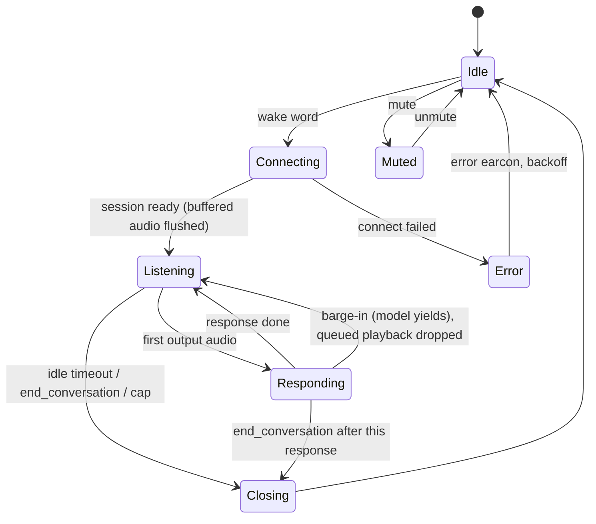

# Software

Design only; no code yet. Everything in the conversation path is one Rust daemon, `alexsay`. Home Assistant runs beside it in Docker.

## Repository layout (planned)

Same conventions as LetterBox: Nix flake, `just` recipes, host-tested logic separated from I/O.

| Path | What |
|---|---|
| `core/` | No I/O, host-tested: session state machine, GPT-Live and realtime event types (serde), playback EQ (biquads), resampler wrapper, ring buffer, tool schemas and argument validation |
| `daemon/` | The `alexsay` binary: ALSA capture/playback (`alsa`), WebSocket client (`tokio-tungstenite`), Home Assistant client (`reqwest`), wake word (`ort`, ONNX Runtime), systemd notify |
| `deploy/` | `alexsay.service`, Home Assistant `compose.yaml`, udev rule for the Flex (vendor `2886`) |
| `scripts/` | Wake-word recording and dataset tools |
| `flake.nix`, `justfile` | Toolchain incl. `aarch64-unknown-linux-gnu` cross target; `just test`, `just build-device`, `just deploy-device`, `just logs` |

## State machine



- Wake-word detection runs only in `Idle`. In a session "Alexsay" is an ordinary word.
- Mic audio streams to the backend for the whole session; GPT-Live decides turns (native full-duplex turn-taking).
- `Connecting` never drops audio: capture keeps filling the ring buffer and the whole backlog is sent once the socket is ready.

## Audio

| Path | Format | Notes |
|---|---|---|
| Capture (Flex, 6 ch image) | 16 kHz, 32-bit, 6 ch | use ch1 (ASR beam); ch2 to ch5 only for recording datasets |
| Capture (Flex, 48 kHz image) | 48 kHz, 2 ch | ch1 ASR beam |
| GPT-Live in/out | PCM16 mono 16 kHz (`audio/pcm`, `rate: 16000`), base64 in JSON events | fixed at `session.start` for both directions; matches io16, so no resampling |
| `gpt-realtime` fallback in/out | PCM16 mono 24 kHz | needs resampling |
| Playback (Flex) | 16 kHz or 48 kHz to match the image | exact channel count/format from `aplay --dump-hw-params` on the bench |

- Open ALSA devices **by card name** from config, never by index (indices move with USB order).
- 10 ms periods, 4-period buffer. Audio threads run `SCHED_FIFO`.
- Resampling with `rubato` only where rates differ: io48 firmware (48 to 16 kHz) or the `gpt-realtime` fallback (16 to 24 kHz).
- Playback chain: 16 kHz deltas → EQ (high-pass ~150 Hz, peaking cut at the box's fc, see [device-design.md](device-design.md#acoustics)) → limiter at −3 dBFS → ALSA. All of it before the XVF3800, so its AEC reference matches what the speaker plays.
- Keep the playback queue short (≤ 100 ms ahead of the DAC) so a barge-in stops the voice quickly. Playback position = frames written minus `snd_pcm_delay`; the `gpt-realtime` fallback needs it for `conversation.item.truncate`.
- Ring buffer: 2 s of ASR-beam audio, always running, so "Alexsay, turn the lights off" spoken in one breath arrives whole.

## Voice backend

```rust
trait VoiceBackend {
    async fn connect(&self, config: &SessionConfig) -> Result<Box<dyn VoiceSession>, BackendError>;
}

trait VoiceSession {
    async fn send_audio(&mut self, pcm16_24k: &[i16]) -> Result<(), BackendError>;
    async fn next_event(&mut self) -> Result<SessionEvent, BackendError>;
    async fn send_tool_result(&mut self, call_id: &str, output: serde_json::Value) -> Result<(), BackendError>;
    async fn interrupt(&mut self, item_id: &str, played_ms: u32) -> Result<(), BackendError>;
    async fn close(self: Box<Self>) -> Result<(), BackendError>;
}
```

| Backend | Endpoint | Model | Status |
|---|---|---|---|
| `Live` | `wss://api.openai.com/v1/live/sessions` | `gpt-live-1` | **Primary.** GA since 10 Sep 2026, $0.05/min billed per second plus the delegated backend model; paid tiers only (Free not supported), 50 concurrent sessions on Build tier |
| `Realtime` | `wss://api.openai.com/v1/realtime?model=gpt-realtime` | `gpt-realtime` | Fallback, same trait |

GPT-Live events the daemon uses (WebSocket guide, Oct 2026; confirm against the API reference when writing the client):

| Direction | Event | Use |
|---|---|---|
| out | `session.start` | first message: `model`, instructions, `audio.format {type: audio/pcm, rate: 16000}`, `audio.output.voice`, `delegation {type: responses, responses: {model, instructions, tools, tool_choice}}` |
| in | `session.started` | session id; only then send audio |
| out | `session.input_audio.append` | mic audio (raw PCM, base64, even byte length) |
| out | `session.input_audio.mute` / `.unmute` | daemon mute state (doesn't stop speech already generated) |
| in | `session.output_audio.delta` | playback |
| in | `session.input_transcript.delta`, `session.output_transcript.delta` | logs |
| in | `response.event` wrapping `response.output_item.done` (function call: `call_id`, `name`, `arguments`) | run a tool |
| out | `response.item.create` (`function_call_output`, matching `call_id`), then `response.create` | tool result |
| out | `session.update` / in `session.updated` | change instructions, tools |
| out | `session.close` / in `session.closed` | end of session |
| in | `error` | log, earcon, close |

- Delegation mode is fixed per session; GPT-Live speaks while the backend model reasons and calls tools.
- Interruption events aren't documented in the WebSocket guide; read "Managing sessions" (`docs/guides/live-conversations`) before writing the playback flush.

`gpt-realtime` fallback events (GA names):

| Direction | Event | Use |
|---|---|---|
| out | `session.update` | instructions, voice, PCM 24 kHz in/out, `semantic_vad`, tools |
| out | `input_audio_buffer.append` | mic audio |
| out | `conversation.item.create` (`function_call_output`) + `response.create` | tool results |
| out | `response.cancel`, `conversation.item.truncate` | barge-in |
| in | `input_audio_buffer.speech_started` | barge-in trigger while `Responding` |
| in | `response.output_audio.delta` / `.done` | playback |
| in | `response.function_call_arguments.done` | run a tool |
| in | `response.done` | usage (tokens) for the cost log |
| in | `error` | log, earcon, close |

Ending a session. GPT-Live has no idle timeout of its own and bills open voice time (`session.usage.updated` → `usage.seconds`), so the daemon decides when to hang up:

| Trigger | How | Notes |
|---|---|---|
| User says goodbye ("thanks, that's all", "bye", "stop") | backend model calls `end_conversation`; the daemon sends `session.close` once the current reply has played | model judgement, so "stop talking" mid-answer is a barge-in, not a hang-up |
| Silence | no user speech (local VAD on the ASR beam) **and** no assistant audio for 10 s | timer paused while a tool call is pending or audio is playing; "hold on" / "wait" extends it to 60 s via `extend_listening` |
| Hard cap | 10 min per session | stops a TV or radio keeping a session alive |
| Daily budget | session minutes per day in config | refuse new sessions with an earcon once spent |

- Close sequence: `session.close` → wait for `session.closed` (reasons: `close_requested`, `expired`, `content`, `remote_hangup`, `connection_lost`) → closing earcon → wake word armed again.
- `session.close` cancels queued backend work, so never close while a function result is outstanding.
- Earcons: wake (< 150 ms), closing, error, muted. They play through the Flex, so the AEC removes them from the mic stream.
- Log `usage.seconds` and backend tokens per session.

## Wake word: "Alexsay"

- **openWakeWord** pipeline in-process: 16 kHz, 80 ms frames → melspectrogram model → embedding model → custom "alexsay" classifier, all ONNX through `ort`.
- Fires on score ≥ threshold for 2 consecutive frames; 2 s refractory period.
- **Training:**
  - Positives: openWakeWord's synthetic set (Piper TTS voices) plus ~200 real takes from this device (ASR beam and raw channels, 6 ch image), several speakers and distances.
  - Positives include the spoken pronunciations "Alexei" and "Aleksey" (that is how the brand is said).
- Negatives: "Alexa", **"Alexa, say..."** (near-identical sound), "Alex", "Alex says", "Alexander", "Alexis", "a lexicon", plus TV and podcast audio and 24 h of household audio from the device.
- Targets: < 1 false accept per 24 h of household audio, > 90 % detection at 3 m (see [measurements.md](measurements.md)).
- Phase 1 shortcut if the ONNX port takes time: the `wyoming-openwakeword` container plus a Wyoming client in the daemon.
- Alternative: microWakeWord (TFLite, smaller), if openWakeWord's false-accept rate on "Alexa" can't be trained down.

## Tools (function calling)

| Tool | Arguments | Calls | Guard |
|---|---|---|---|
| `ha_list_entities` | `area?` | `GET /api/states`, filtered | only entities in the exposed list in config |
| `ha_get_state` | `entity_id` | `GET /api/states/{entity_id}` | exposed list |
| `ha_call_service` | `domain`, `service`, `entity_id`, `data?` | `POST /api/services/{domain}/{service}` | allow-listed domains (`light`, `switch`, `climate`, `cover`, `media_player`, `scene`, `script`); `lock` and `alarm_control_panel` need a spoken confirmation turn |
| `get_time` | none | local clock, Europe/London | |
| `end_conversation` | none | closes after the current response | |
| `extend_listening` | `seconds?` (max 120) | stretches the silence timeout once | |

- Home Assistant at `http://127.0.0.1:8123` with a long-lived access token.
- Tool arguments are validated in `core` before any HTTP call; the model never gets raw HA errors with tokens or URLs in them.

## Sound controls (16 Oct 2026)

| Piece | Where |
|---|---|
| App | Devices, the sound button on a speaker's row: volume slider (0 to 100, sent when released) and a microphone mute switch; `POST /api/devices/:id/sound`, any home member; 409 when the speaker is offline |
| Server | Pushes `sound.set {volume?, mic_muted?}` over the speaker's line; keeps the state in `devices.last_meta` from the speaker's `sound` line message (on connect and after each change) and from every heartbeat (`volume`, `mic_muted`); `GET /api/devices` carries `sound` |
| Speaker | `Player::set_volume` (an atomic read by the output callback, so running audio follows), the level saved to `config.toml`; `CallState.mic_muted` silences the capture pump for everything; both confirmed by the ready tick and reported back |

## Music (Spotify, 16 Oct 2026)

| Piece | Where |
|---|---|
| Connection | Each home registers its own Spotify app (Development Mode since 11 Feb 2026: the developer's own account on Premium, a Family or Duo member account does not qualify, one app per account, 5 allow-listed users; Extended Quota needs a company with 250k monthly users). `PUT /api/connections/spotify {client_id, client_secret}` seals the pair and resets the sign-in; `GET /api/connections/spotify/authorize` redirects to `accounts.spotify.com/authorize` with an HMAC-signed `state` (home and 10 min expiry under `SECRETS_KEY`, nothing stored); `GET /api/connections/spotify/callback` is mounted before the session check (the browser arrives from accounts.spotify.com cross-site, without the `SameSite=Strict` cookie) and takes the home from the signed state, exchanges the code (`api/src/providers/spotify.ts exchangeCode`), reads `/me` and stores `settings {authorized, account, premium, market}`, then sends the browser back to `/#spotify`. Redirect URI `{origin}/api/connections/spotify/callback`, registered word for word in the Spotify app; Spotify allows https or loopback only, so a self-hosted server needs https (a tunnel) for the sign-in. `spotifyToken()` refreshes like Lightwave's and re-seals a rotated refresh token. |
| Tools (`api/src/music_tools.ts`, `needs: "spotify"`, present once the account signed in) | `list_playlists`; `play_music {query?, kind?, speaker?}`: the user's own playlists by name first, then Spotify search (the asked-for kind, else the first track, or the artist when the whole query is their name), `PUT /me/player/play?device_id=` with a `context_uri` or `uris`; no query resumes (a 404 "no active device" transfers playback to the target first); `pause_music`, `skip_track {direction}`, `now_playing`, `set_music_volume {percent}`. Spotify's PREMIUM_REQUIRED and NO_ACTIVE_DEVICE answers come back as plain sentences. |
| Where it plays | `targetDevice()` in `api/src/spotify.ts`: the device the user named, else the speaker the tool call came from (a Spotify Connect device with the speaker's name), else Spotify's active device, else the only device; several and no hint: the model asks. |
| The speaker as a Connect device (0.1.9) | `daemon/src/music.rs` on librespot 0.8: signs in with stored credentials or a token from `GET /v1/device/spotify/token`, appears in the Spotify app under the speaker's name, decodes to 44.1 kHz stereo which `LaneSink` folds to mono at the card's rate into the player's music lane, mixed under speech by the output callback; ducked to -16 dB under a conversation or alarm, paused for phone calls and resumed after; the Spotify app's volume goes through librespot's soft mixer, the speaker's volume on top |

## Telephony (Twilio)

| Flow | Path |
|---|---|
| Speaker phone line | `LineBridge` Durable Object per device: speaker WebSocket plus Twilio media stream; host leg is the number calling itself with `<Dial><Conference>`, the inbound side answers `<Connect><Stream>`; 8 kHz mu-law relayed both ways; `alexsay call mute|unmute|hangup` over the control socket; the call report is handed to the open conversation as a message item |
| Session context | `localeInstructions()` first: date, clock, language, currency and date samples from `users.locale` and `users.timezone`; then memories, recent conversations, tool guidance |
| Assistant calls someone | `place_call`: conference in stages. Host leg first (the page as `client:alexsay-app`, or `my_number` on request); host answered (page report, leg callback or conference `participant-join`) dials the guests and seats the assistant right behind them over SIP (`sip:{project_id}@sip.api.openai.com`, header `X-Alexsay-Conference`). OpenAI's `realtime.call.incoming` webhook at `/v1/openai/webhook` is accepted with the briefing and all tools; the `CallAgent` Durable Object runs the assistant's function calls over the realtime socket (`https://api.openai.com/v1/realtime?call_id=` with an Upgrade fetch); `call_status` reads each leg live from Twilio; transcripts land in `call_turns`, the end in `call_reports`, and the page pushes the report into its GPT-Live session (`response.item.create` message item) when its leg drops. `call_test` dials a scripted OpenAI agent (`X-Alexsay-Agent` header) instead of a person |
| The assistant's seat on a call (15 Oct 2026) | Two engines, chosen in the OpenAI connection (`call_engine`, default `live`). **GPT-Live**: `seatLive` claims the seat row (`phone` `assistant:live`), the number calls itself with `conferenceSeatTwiml` (a plain participant, or the host when the assistant takes an incoming call alone), a `bridges` row `live:<leg id>` ties the inbound side to the `LiveSeat` Durable Object (`api/src/live_seat.ts`, named `live:<leg id>`): Twilio's stream (8 kHz mu-law) is bridged to a GPT-Live WebSocket (`liveSocketUrl`, `session.start` with `liveCallSession`: the call briefing as instructions, the call tools, and G.711 mu-law at 8 kHz as the session's audio format, `LIVE_CALL_FORMAT`, so Twilio's bytes pass through untouched both ways, 100 ms per append; resampling to PCM and back had folded everything above 4 kHz into the speech band as hiss, 15 Oct 2026), function calls run through `runCallTool`, transcripts land in `call_turns` (flushed when the other side starts, when the backend's reply completes, and at the end), `/notify` carries "X answered" as a user note, either side closing ends the seat (`endAssistant`, or `setLeft` for an agent). Scripted test agents go the same way (`dialLiveAgent`, `agentBrief`, `leave_call` only). Needs only an OpenAI key and a public origin. **Realtime**: the SIP leg and `CallAgent` as before (project id and webhook secret); GPT-Live falls back to it when seating fails and SIP is set up. Twilio's media streams carry 8 kHz mu-law only and are not configurable, and the PSTN leg is G.711 too, so narrowband is the line's ceiling either way; the seat now reaches it with no loss of its own. Tests: `api/test/call_seat.test.ts` runs the same scenarios for both engines, with GPT-Live played by a relay worker (`api/test/fake_live.mjs`, an auxiliary Miniflare worker, since a socket made in the seat's own context cannot be driven from the test); `api/test-llm/calls.llm.ts` drives the seat against the real model |
| A call taken on the speaker (15 Oct 2026) | The speaker's own GPT-Live session is the assistant, always present: no seat is dialled when the speaker's software is 0.1.6 or newer (`HostBrief.assistant_on_speaker`, from the firmware the heartbeat reports, `api/src/version.ts`; set when a call is placed from the speaker and when the speaker answers an incoming one). The stream's `assistant` parameter ("speaker" or "seat") reaches the daemon in `call.start`. On the Pi: the call does not take the speaker over; a session opens if none is on (`Opening::Call`) with `incoming::on_call_note` as context (quiet unless addressed, `end_call` hangs up); the far side's audio is played and mixed into what GPT-Live hears (`CallState::far_in`, echo cancelling keeps it out of the microphone); the reply plays in the room and is mixed into the line (`Mixer`, as drop-ins); the session is held open for the length of the call (`Session::set_held`: no idle, cap or goodbye closes it, only being asked to stop) and closes by its ordinary rules once the call ends; no call report is handed back, the session heard it all. Calls answered on the app or the mobile still get the server's GPT-Live seat |
| Spoken message | `place_call` with `message`: `POST Calls.json` to the person with `<Say>` |
| Drop in (app to speaker) | `GET /api/devices/:id/drop-in` (WebSocket, home members) joins the speaker's `LineBridge` as the guest: the speaker gets `drop_in.offer {id, from}`, the app `ringing`; the speaker plays a doorbell, opens a GPT-Live conversation that says "<name> is dropping in. Accept?" and answers with its own `accept_drop_in` / `reject_drop_in` tools (added to the session on the speaker, never run on the server; no answer within the session's idle time is a no; 30 s on the bridge is `no_answer`); `drop_in.answer {id, accept}` opens it: the app hears `accepted`, the speaker `call.start {kind: "drop_in"}`, then 8 kHz mu-law frames both ways (the browser encodes in `app/src/lib/mulaw.ts`, captures through an audio worklet, plays through Web Audio). The wake word stays on during a drop-in: "Alexsay" opens a conversation with `end_drop_in` added, the reply plays in the room and is mixed into the frames going out (`core::drop_in::Mixer`), and the far side's audio waits while the assistant speaks. Ends: `hangup` from either side, the app's socket closing, the speaker's line dropping, 40 s without speech on either side (`drop_in.ts`: frame RMS over 1%), each told to the app as `ended {reason}`; the speaker gets `call.end` (or `drop_in.cancel` while still asking). A busy speaker (phone call, drop-in, alarm ringing) declines at once. The `drop_in` tool (app only) names the speaker for the page, which opens the same dialog as the Devices list's button (confirmed first; shown for online speakers on 0.1.4 or newer from a browser with Web Audio and a microphone). Self-hosted servers carry it the same way: the bridge is the same Durable Object under workerd |
| Browser phone line | `GET /api/twilio/voice-token` (Access Token, Voice grant, incoming only; API key created once via `Keys.json`); the page registers on Start talking, auto-accepts its own conference legs, shows Answer/Decline for real calls, mutes GPT-Live while connected |
| Group call | `start_conference`: `POST Conferences/{name}/Participants.json` for the host (`EndConferenceOnExit`) then each person; `add_to_call` adds to the latest open conference |
| Text, WhatsApp | `send_text`, `send_whatsapp`: `POST Messages.json`, `whatsapp:` prefix on both ends; free text only inside the 24 h window |
| Incoming call (15 Oct 2026) | Twilio `POST /v1/twilio/voice`, owner found by `To`; `api/src/incoming.ts`. Policy `incoming_calls` (off: `<Hangup/>`; contacts only: strangers are told and hung up on; everyone). Allowed: the caller hears the greeting (`<Say>`, Twilio's own Polly voice, so it plays whatever the assistant is doing; text and `{name}` from the Twilio settings) and waits in a conference `in-...` of their own (`startConferenceOnEnter=false`, hold music) while every speaker is pushed `call.incoming` (doorbell, "Call from Mum. Answer?", local tools `answer_call` and `reject_call`), the app is dialled as `client:alexsay-app?incoming=<conference>&from=<name>` (rings with Answer/Decline instead of auto-accepting) and the mobile as a host participant. A speaker answers through `POST /v1/device/calls/:conference/answer` (`mode: speaker`: the number calls itself for the stream as for a placed call; `mode: assistant` with an `instruction`: the assistant's SIP leg joins as host and speaks for the user, offers to take a message, `take_message` keeps it as a notification and reads it out, then `end_call`, which ends a host-less conference through the assistant's own seat; a delegated call ending without `take_message` keeps the caller's words from the transcript instead, `messageFromTranscript`). Ringing host legs do not end the conference on exit, and a `conference-end` while the caller has not yet joined and nobody answered (`stillRinging`) is ignored: the app's leg failing at once when the app is closed empties the new conference, and the caller joins a fresh instance under the same name. Whichever side answers first, `cancelOtherRinging` completes the other host legs and pushes `call.incoming.cancel`; `hostAnswered` on an incoming brief seats the assistant with the incoming briefing (quiet unless addressed, or acting on the instruction). A scheduler job `call.unanswered` 40 s later redirects a still-waiting caller to the unanswered message (`<Say>` + `<Hangup/>`), marks the call `no-answer`, and notifies the home (`Missed call from ...`) |
| Incoming text | `POST /v1/twilio/messages`: policy `incoming_messages` (off and strangers under contacts only are dropped with a log line); kept in `messages`, a notification (`Text from Mum`) is stored and pushed to the speakers as `notify` (a ding, then the text read out) |
| Notifications and Messages | `notifications` table (kinds `call`, `message`, `note`; `read_at`); `GET /api/notifications`, `POST /api/notifications/read`, `GET /api/messages`, `GET /api/twilio/calls?limit=`; the app's **Messages** tab (Notifications, SMS, Calls; reply, call back, mark read); tools `recent_calls`, `list_notifications`, `mark_notifications_read`, `take_message` (`incoming_tools.ts`); replies and call-backs are `send_text` and `place_call` |
| Speaker dials out | SIP INVITE to the Twilio SIP domain, Twilio `POST /v1/twilio/voice/outbound`, `<Dial callerId=from_number>` |
| Incoming text | `POST /v1/twilio/messages`, stored against the contact by number |
| Status | `POST /v1/twilio/status` updates `calls.status` by CallSid |

- Every webhook is verified with the owner's auth token (HMAC-SHA1 over URL + sorted params) before anything is written.
- Daemon side (to do): baresip registers `sip:{deviceId}@{sip_domain}` with the credentials from `/etc/alexsay/env`; the heartbeat carries `telephony {sip_domain, sip_username, from_number}`. Call audio goes through the same XVF3800 path as the assistant, so AEC holds.

## Configuration

`~/.local/alexsay/config.toml` (no secrets; `alexsay config init` writes it with every default and a comment):

```toml
[server]      url = "https://app.alexsay.com", poll_s = 30
[audio]       input = "auto", output = "auto", channel (0-based; unset = the Flex's voice, channel 0, on a Flex build, else the average), volume = 0.8, gain = 1.0, echo = "auto" (hardware on the Flex, software AEC3 elsewhere, or none)
[wake]        enabled = true, model = "builtin" | "data/models/alexsay.rpw", sensitivity = 0.5, refractory_s = 2.0
[session]     idle_timeout_s = 20, after_reply_s = 8, max_minutes = 10, end_on_farewell = true, preroll_s = 1.5
[sounds]      enabled = true, startup = true
[update]      auto = true, check_hours = 6, repository = "andreasbros/alexsay"
[log]         level = "info", keep_days = 7
```

`data/` beside it: `identity` (0600), `state.json`, `logs/`, `models/`, `recordings/`, `cache/`. The owner's OpenAI key arrives in the heartbeat over TLS and stays in memory.

## Deployment

- One static binary per platform from the GitHub release (`just release`, `.github/workflows/release.yml`); `curl -fsSL https://alexsay.com/install.sh | sh` or `irm https://alexsay.com/install.ps1 | iex` installs it; `alexsay setup`, `alexsay service install`.
- **Pi:** Raspberry Pi OS Lite 64-bit, the aarch64 build (musl, `flex` feature), `alexsay service install` as the `pi` user with `loginctl enable-linger`, or as root for a system unit. Home Assistant in Docker Compose (`network_mode: host`) alongside.
- **Updates:** the binary checks GitHub every `update.check_hours`, verifies `SHA256SUMS.sig` with the release key built in, swaps itself and restarts, announcing the version by voice.

## Latency budget

| Step | Target |
|---|---|
| End of "Alexsay" → detection | ≤ 200 ms |
| WebSocket connect + `session.update` | 300 to 600 ms, overlapped with the user still talking |
| End of user speech → server end-of-turn | 200 to 500 ms (semantic VAD) |
| End-of-turn → first output audio | 300 to 700 ms |
| First delta → sound | ≤ 60 ms |
| **End of user speech → first sound** | **≤ 1.2 s** |

## Testing

- `core`: state-machine transitions (barge-in, network drop mid-response, tool call during barge-in), event parsing against recorded JSON fixtures, EQ coefficients against reference values, resampler latency and level.
- `daemon`: integration test against a fake Live server (`tokio-tungstenite`) with WAV files standing in for ALSA.
- Bench: the measurement plan in [measurements.md](measurements.md).
